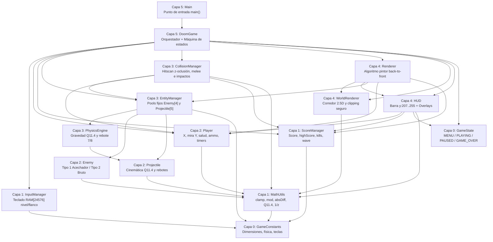

# DOOM // HELLGATE 16: Abismo de Silicio

> **Motor FPS Pseudo-3D de Bajo Nivel en Arquitectura Hack (16-bit) y Lenguaje Jack**


### Autores / Equipo de Ingeniería

| Integrante | Rol en Ingeniería de Bajo Nivel |
| :--- | :--- |
| **Ikker Mateo Gil Jordán** | Arquitectura DAG, Motor Pseudo-3D, Física Q11.4 y QA Automatizado |
| **Juan Fernando Gómez** | Integración de Sistemas, Validación Funcional y Sustentación |

---

## Video de Demostración y Arquitectura (YouTube)

> 🎥 **Video de Funcionamiento en YouTube:** https://youtu.be/OjcbvD-KOkM
> **Arquitectura y explicación del proyecto** https://coruscating-otter-f3400e.netlify.app

---

## Concepto y Factor Diferenciador

**HELLGATE 16** (*"Abismo de Silicio"*) es un videojuego *First-Person Shooter* pseudo-3D en primera persona desarrollado íntegramente en lenguaje **Jack** sobre la plataforma **Hack de 16 bits** (`512 × 256` píxeles monocromáticos de 1 bit, CPU sin punto flotante ni GPU dedicada y espacio de memoria restringido).

Ambientado en el año 2096 dentro de un conducto subterráneo de contención de la estación minera *Tartarus-16*, el jugador se desplaza lateralmente por el corredor, ajusta su mira vertical, gestiona un cargador de `24` disparos, abate dos arquetipos de enemigos que avanzan escalando en perspectiva (`Acechador Abisal` Tipo 1 y `Bruto Ígneo` Tipo 2) y esquiva orbes de magma balísticos sometidos a gravedad discreta y rebotes reales.

### ¿Qué hace único a este proyecto frente a juegos genéricos en Jack de repositorios web?

1. **Verdadero Motor Pseudo-3D en Perspectiva Inversa (`1/z`) sin Trigonometría**: Mientras la mayoría de repositorios públicos en Jack implementan clones 2D planos (Snake, Pong o Tetris estáticos), **HELLGATE 16** proyecta un corredor 3D con desplazamiento axial perpetuo (`scrollPhase`), punto de fuga con paralaje horizontal (`vpX`) y ordenamiento espacial de entidades (*algoritmo del pintor* de atrás hacia adelante).
2. **Física Balística en Punto Fijo `Q11.4`**: Los proyectiles enemigos describen trayectorias parabólicas reales en subunidades enteras (`fpScale = 16`), con aceleración gravitacional constante y coeficientes de restitución diferenciados al colisionar contra suelo, techo y paredes.
3. **Cero Asignaciones Dinámicas en Partida (*Zero-Leak Architecture*)**: Mediante *object pooling* estático (`enemies[4]`, `projectiles[5]`), índices preasignados (`sortIdx[4]`) y `17` instancias `String` reutilizables en el `HUD`, el juego consume una fracción fija del *heap* (`~4.0%`) sin fragmentación ni riesgo de desbordamiento `Sys.error(6)` tras múltiples reinicios.
4. **Inmunidad Total ante Errores de Pantalla (`Sys.error(7..13)`) y Parpadeo (*Flicker*)**: Todas las primitivas visuales pasan por un recortador geométrico *Cohen-Sutherland* (`WorldRenderer.drawSafeLine/Rect/Circle`) estrictamente acotado al visor superior (`y: 0..206`), aislando físicamente el panel `HUD` inferior (`y: 207..255`).

---

## Cumplimiento de Requisitos Técnicos (Evidencia)

| Requisito de Evaluación | Clases Reales en `src/` | Métodos, Campos y Parámetros Implementados | Mecanismo Verificado de Bajo Nivel | Cobertura QA en `tests/` |
| :--- | :--- | :--- | :--- | :--- |
| **1. Interactividad por teclado en tiempo real (sin pausas bloqueantes)** | `InputManager`, `DoomGame`, `Player` | `InputManager.poll()`, `normalizeKey()`, `isMoveLeftHeld()`, `isMoveRightHeld()`, `isAimUpHeld()`, `isAimDownHeld()`, `isFireHeld()`, `isStartTriggered()`, `isPauseTriggered()`, `isReloadTriggered()`, `isRestartTriggered()`, `isMenuExitTriggered()` | Lectura no bloqueante directa en `Keyboard.keyPressed()` (`RAM[24576]`). Normaliza minúsculas ASCII (`97..122` $\to$ `65..90`), separa consulta por nivel continuo (movimiento, mira y fuego con `fireCooldownTicks = 4`) y detección por flanco de subida (pausa `P`, recarga `R`, inicio `Espacio`/`Enter`, regreso `ESC`), congelando por completo el gameplay en `MENU`, `PAUSED` y `GAME_OVER`. | `InputScoreTest` (`40/40`), `PlayerHudTest`, `DoomGameTest` (`40/40`) |
| **2. Fondo móvil / Entorno dinámico** | `WorldRenderer`, `MathUtils`, `Renderer`, `DoomGame` | `WorldRenderer.advanceScroll(2)`, `renderCorridor(vpX)`, `MathUtils.computeVanishingX(playerX)`, `MathUtils.mod()`, `drawSafeLine()`, `drawSafeRect()`, `drawSafeCircle()` | Fase axial cíclica `scrollPhase` en `[0..15]` proyectada sobre `4` anillos perspectivos `zRing = (i * 20) + (20 - scrollPhase)` con factor `1/z` (`focalLength = 64`). El desplazamiento lateral del jugador (`playerX` en `[-160, +160]`) mueve por paralaje inverso el punto de fuga `vpX` entre `216` y `296` cada fotograma. | `WorldRendererTest` (`36/36`), `DoomGameTest` (`40/40`) |
| **3. Comportamiento físico modelado matemáticamente** | `PhysicsEngine`, `Projectile`, `EntityManager`, `CollisionManager`, `MathUtils` | `PhysicsEngine.updatePool()`, `updateProjectile()`, `Projectile.setKinematics()`, `registerBounce()`, `MathUtils.toFixed()`, `fromFixed()`, `CollisionManager.resolveWorldInteractions()` | Integración discreta en punto fijo `Q11.4` (`fpScale = 16`): avance axial `z(t+1) = z(t) - vz` hasta `zNearClip = 8`, gravedad constante `gravity = 12` (`0.75 u/tick^2`) saturada en `maxVy = 240`, rebote inelástico contra suelo `fpFloorY = 1440` con restitución `7/8` (`restitutionNum = 7`, `restitutionDen = 8`), y rebote elástico en techo `fpCeilY = -1440` y paredes `+-fpMaxX = +-2560`. Enemigos calculan `vx` balístico hacia `playerX`. | `EntitiesPhysicsTest` (`44/44`), `CollisionRendererTest` (`36/36`) |
| **4. Visualización dinámica de puntaje y estado (HUD)** | `ScoreManager`, `HUD`, `Renderer`, `CollisionManager`, `GameState` | `ScoreManager.registerKill()`, `addBonus()`, `reset()`, `HUD.markDirty()`, `drawStaticFrame()`, `updateIfNeeded()`, `clearTextField()`, `renderMenuScreen()`, `renderPauseOverlay()`, `renderGameOverOverlay()` | Banda inferior aislada (`y: 207..255`, divisor doble `RAM[23008] = -1`). Muestra salud numérica y barra proporcional, munición (`ammo/24`) con alerta `RECARGA [R]`, puntaje saturado en `30000` (`+100` Tipo 1 / `+250` Tipo 2), bajas, oleada (`1 + kills / 5`), estado (`JUEGO`/`PAUSA`/`FIN`) y récord de sesión (`highScore`). Solo redibuja cuando `isDirty = true`. | `InputScoreTest` (`40/40`), `PlayerHudTest` (`40/40`), `CollisionRendererTest` (`36/36`), `DoomGameTest` (`40/40`) |

---

## Arquitectura del Sistema

### Diagrama de Flujo y Dependencias (DAG — 6 Capas, 16 Clases)



### Inventario de Clases en `src/`

| Capa | Clase | Tipo Jack | Responsabilidad Exacta en el Proyecto |
| :---: | :--- | :--- | :--- |
| **0** | `GameConstants` | Estática pura | Centraliza resolución (`512×256`), partición `HUD` (`y=207`), límites del túnel (`[-160, 160]×[-90, 90]`), constantes `Q11.4`, `frameDelayMs = 25` y códigos `Keyboard`. |
| **0** | `GameState` | Estática pura | Expone identificadores enteros `menu() = 0`, `playing() = 1`, `paused() = 2` y `gameOver() = 3`. |
| **1** | `MathUtils` | Estática pura | Aritmética segura en 16 bits (`clamp`, `mod` no negativo, `absDiff` saturado), conversión `Q11.4` (`toFixed`, `fromFixed`) y proyección `1/z` (`computeVanishingX`, `projectX/Y/Size`). |
| **1** | `InputManager` | Instancia única | Sondeo no bloqueante sobre `Keyboard.keyPressed()`, normalización minúsculas $\to$ mayúsculas y predicados por nivel y flanco. |
| **1** | `ScoreManager` | Instancia única | Gestiona `score`, `highScore`, `kills` y `wave` (`+100` Tipo 1, `+250` Tipo 2), con saturación segura en `30000`. |
| **2** | `Player` | Instancia única | Estado del jugador (`x`, `aimY`, `health = 100`, `ammo = 24`) y temporizadores `fireCooldown`, `flashTimer`, `recoilOffset`, `invulnTimer`. |
| **2** | `Enemy` | *Pool* de `4` | Entidad enemiga parametrizable en Tipo 1 (`2 HP`, `speedZ = 2`, `15` melee) y Tipo 2 (`4 HP`, `speedZ = 1`, `25` melee, silueta `+25%`), con rebote lateral y *hit flash*. |
| **2** | `Projectile` | *Pool* de `5` | Proyectil enemigo en punto fijo `Q11.4` (`fpX`, `fpY`, `vx`, `vy`, `vz`, `damage`, `bounceCount`). |
| **3** | `PhysicsEngine` | Estática pura | Integrador discreto por tick sobre `Projectile`: avance `z`, gravedad `+12`, velocidad terminal `240` y rebotes con restitución `7/8`. |
| **3** | `EntityManager` | Instancia única | Administra los arreglos fijos `enemies[4]` y `projectiles[5]`, generador LCG seguro de 16 bits (`tickSeed`, `nextRandomBounded`) y *spawner* progresivo por oleada. |
| **3** | `CollisionManager` | Estática pura | Disparo *hitscan* con margen de `4` px y oclusión estricta por menor `z`, disparos enemigos dirigidos y detección de daño melee/proyectil al jugador. |
| **4** | `WorldRenderer` | Instancia única | Dibuja el corredor 2.5D con `scrollPhase` (`4` anillos `1/z`) y expone primitivas blindadas `drawSafeRect`, `drawSafeLine` (Cohen-Sutherland + división larga binaria) y `drawSafeCircle`. |
| **4** | `HUD` | Instancia única | Preasigna `17 String` constantes, dibuja marco y barra de salud en `y: 207..255`, limpia residuos con `clearTextField` (acotando `col <= 57`) y renderiza pantallas `MENU`, `PAUSED` y `GAME_OVER`. |
| **4** | `Renderer` | Instancia única | Ordena `sortIdx[4]` de mayor a menor `z` (*insertion sort* in-place), intercala enemigos y proyectiles, dibuja mira central despejada (`5×5`) y arma con retroceso/fogonazo, y sincroniza el `HUD`. |
| **5** | `DoomGame` | Orquestador raíz | Posee las `7` instancias subsistema, despacha el bucle `run()` a `25 ms/tick`, traduce controles por estado y libera recursos en orden inverso en `dispose()`. |
| **5** | `Main` | Entrada única | Invoca `DoomGame.new()`, `game.run()` y `game.dispose()`. |

### Estructura Real de Directorios (`C:/DoomProject/`)

```text
C:/DoomProject/
├── src/                               # Código fuente Jack y bytecode VM (32 archivos: 16 .jack + 16 .vm; 0 OS/*.vm)
│   ├── Main.jack / .vm
│   ├── DoomGame.jack / .vm
│   ├── GameConstants.jack / .vm
│   ├── GameState.jack / .vm
│   ├── MathUtils.jack / .vm
│   ├── InputManager.jack / .vm
│   ├── ScoreManager.jack / .vm
│   ├── Player.jack / .vm
│   ├── Enemy.jack / .vm
│   ├── Projectile.jack / .vm
│   ├── PhysicsEngine.jack / .vm
│   ├── EntityManager.jack / .vm
│   ├── CollisionManager.jack / .vm
│   ├── WorldRenderer.jack / .vm
│   ├── HUD.jack / .vm
│   └── Renderer.jack / .vm
├── tests/                             # 7 suites automatizadas en VMEmulator (280/280 aserciones aprobadas)
│   ├── Module1Test/                   # 44 aserciones (GameConstants, GameState, MathUtils)
│   ├── InputScoreTest/                # 40 aserciones (InputManager, ScoreManager)
│   ├── WorldRendererTest/             # 36 aserciones (corredor, scrollPhase, Cohen-Sutherland, VRAM)
│   ├── PlayerHudTest/                 # 40 aserciones (Player, HUD diferencial, RAM[2049] sin fugas)
│   ├── EntitiesPhysicsTest/           # 44 aserciones (Enemy, Projectile Q11.4, PhysicsEngine, EntityManager)
│   ├── CollisionRendererTest/         # 36 aserciones (CollisionManager hitscan/oclusión, Renderer back-to-front)
│   └── DoomGameTest/                  # 40 aserciones (DoomGame ciclo completo, MENU/PAUSED/GAME_OVER, heap=0)
├── tools/
│   └── test_module1.ps1               # Pipeline PowerShell: compila src/, valida 16 .vm y ejecuta las 7 suites
├── presentacion_doom_hack.html        # Presentación ejecutiva 16:9 (9 diapositivas, Pitch + exportación PDF)
└── README.md                          # Documentación técnica oficial del repositorio
```

---

## Ingeniería de Bajo Nivel y Optimizaciones en Hack

### 1. Aritmética Entera de 16 Bits sin Punto Flotante (`[-32768, 32767]`)
* **Formato en punto fijo `Q11.4` (`fpScale = 16`)**: Las coordenadas de proyectiles (`fpX` en `[-2560, 2560]`, `fpY` en `[-1440, 1440]`) multiplican la unidad física por `16`, permitiendo gravedad fraccionaria (`gravity = 12` equivalente a `0.75` u/tick²) y amortiguamiento `7/8` (`(vy * 7) / 8`, máximo producto `1680`) sin usar *floats*.
* **Proyección perspectiva entera `1/z`**: Usando `focalLength = 64` y plano mínimo `zNearClip = 8`, las diferencias `(worldX - playerX) * 64` nunca superan `32640`, manteniendo toda multiplicación previa a la división dentro del límite positivo de `32767`.
* **División larga binaria de 14 bits en recortes extremos**: En `WorldRenderer.drawSafeLine()`, cuando `|delta * step| > 32767` al recortar segmentos diagonales extensos, el interpolador ejecuta una división larga binaria exacta bit a bit en enteros de 15 bits, evitando tanto el desbordamiento de signo como el error de truncamiento acumulado.
* **Protección de casos borde (`-32768` y saturación)**: `MathUtils.fromFixed` maneja explícitamente `-32768` (donde `Math.abs` de Hack OS desborda), `MathUtils.absDiff` detecta rangos cruzados antes de restar y `ScoreManager` evalúa `(30000 - score)` antes de sumar para impedir que el marcador dé vuelta a negativo.

### 2. Disciplina Sintáctica ante la Ausencia de Precedencia de Operadores en Jack
* La especificación de Jack evalúa operadores sin precedencia estándar ni operadores `!=`, `<=`, `>=`, `&&`, `||` o `%`.
* Todo cálculo aritmético y lógico compuesto en las `16` clases utiliza **parentización explícita estricta** (`((a * b) / c)`), equivalentes negados (`~(a < b)` para `>=`), bitwise `&`/`|` para condiciones compuestas y aritmética modular positiva mediante `MathUtils.mod(a, b)`.

### 3. Gestión Determinística de Memoria (`alloc` / `dispose`) sin Garbage Collector
* **Presupuesto estático fijo**: En `DoomGame.new()` se asignan una sola vez los `7` subsistemas instanciables, los `3` arreglos fijos (`enemies[4]`, `projectiles[5]`, `sortIdx[4]`) y las `17` instancias `String` del `HUD` (~`580` palabras de las `14,336` disponibles en el *heap* `RAM[2048..16383]`, equivalentes al `4.0%`).
* **Cero fugas en partida y reinicios (`RAM[2049]`)**: Durante `startNewMatch()`, combate, física, renderizado 3D y pantallas `MENU`/`PAUSED`/`GAME_OVER`, las ranuras de `Enemy` y `Projectile` se reciclan mediante `spawn()` / `deactivate()`. Las pruebas `PlayerHudTest`, `EntitiesPhysicsTest`, `CollisionRendererTest` y `DoomGameTest` verifican en hardware que el puntero de frontera del *heap* (`Memory.peek(2049)`) retorna un **delta de exactamente `0` palabras**.
* **Propiedad simétrica**: Ningún método de dibujo ni el *game loop* construye literales `"..."`; `DoomGame.dispose()` libera cada módulo una sola vez en orden inverso sin doble liberación (`Renderer.dispose()` solo libera `sortIdx` y su instancia, respetando que `worldRenderer` y `hud` pertenecen a `DoomGame`).

### 4. Optimización de Renderizado y Aislamiento Físico de VRAM (`RAM[16384..24575]`)
* **Erradicación del parpadeo (*Flicker*)**: El `HUD` (`y: 207..255`) jamás es borrado por la limpieza del visor 3D (`WorldRenderer.renderCorridor` limpia únicamente `y: 0..206`). Además, `HUD.updateIfNeeded()` consulta la bandera `isDirty` para ejecutar **cero escrituras de texto o pantalla** en ticks donde ni el estado, salud, munición ni puntaje cambiaron.
* **Protección contra desborde de cursor y errores de video**: `HUD.clearTextField()` acota filas a `[0..22]` y columnas a `[0..57]` antes de imprimir `5` espacios en blanco, impidiendo que `Output.printString` alcance la columna `64` y envuelva hacia el visor 3D (`Sys.error(20)`). `WorldRenderer` recorta toda figura al rectángulo `[0..511] × [0..206]` para impedir errores fatales `Sys.error(7..13)`.

---

## Cómo Compilar, Probar y Ejecutar

### 1. Requisitos del Entorno
* Suite **Nand2Tetris v2.5** (`JackCompiler.bat` y `VMEmulator.bat`).
* Java Runtime (JDK/JRE 64-bit) accesible en el `PATH` o configurado en [`tools/test_module1.ps1`](tools/test_module1.ps1).

### 2. Compilación Completa y Regresión Automatizada (`280/280` Pruebas)
El script automatizado [`tools/test_module1.ps1`](tools/test_module1.ps1) compila las `16` clases de `src/`, verifica la presencia de los `16` archivos `.vm` (manteniendo `src/` libre de copias `OS/*.vm`) y ejecuta de manera aislada las `7` suites en `VMEmulator.bat`:

```powershell
powershell -ExecutionPolicy Bypass -File "C:\DoomProject\tools\test_module1.ps1"
```

Salida esperada al completar el pipeline:
* `Module1Test`: `44 / 44` aprobadas
* `InputScoreTest`: `40 / 40` aprobadas
* `WorldRendererTest`: `36 / 36` aprobadas
* `PlayerHudTest`: `40 / 40` aprobadas
* `EntitiesPhysicsTest`: `44 / 44` aprobadas
* `CollisionRendererTest`: `36 / 36` aprobadas
* `DoomGameTest`: `40 / 40` aprobadas (`280 / 280` acumuladas, `0` fallidas, `RAM[2049]` heap delta `= 0`)

### 3. Ejecución Interactiva del Videojuego en VM Emulator (GUI)
1. Abrir `VMEmulator.bat` de Nand2Tetris en modo gráfico.
2. Seleccionar **File $\to$ Load Program** y elegir la carpeta `C:\DoomProject\src`.
3. Cuando el emulador pregunte por las implementaciones del sistema operativo, **aceptar usar las funciones integradas (*built-in*)** para acelerar el video y reloj en Java nativo.
4. En el panel superior de control:
   * **Animate**: `No animation`
   * **Speed**: `Fast`
5. Presionar el botón **Run (`>>`)** y hacer clic sobre el lienzo de pantalla para enfocar el teclado.

#### Controles del Juego
| Tecla | Acción | Estados Activos |
| :--- | :--- | :--- |
| `Espacio` / `Enter` | Iniciar partida | `MENU` |
| `A` / `←` y `D` / `→` | Movimiento lateral (*strafe* con paralaje) | `PLAYING` |
| `W` / `↑` y `S` / `↓` | Subir / bajar línea de mira (`aimY` en `[72..136]`) | `PLAYING` |
| `Espacio` | Disparar cañón de plasma (*hitscan* + oclusión `z`) | `PLAYING` |
| `R` | Recargar cargador (`24` balas) / Reiniciar partida limpia | `PLAYING` / `GAME_OVER` |
| `P` | Pausar o reanudar partida | `PLAYING` / `PAUSED` |
| `ESC` | Regresar al menú principal (conservando `highScore`) | `PAUSED` / `GAME_OVER` |

### 4. Presentación Interactiva del Proyecto
* Abrir [`presentacion_doom_hack.html`](presentacion_doom_hack.html) directamente en cualquier navegador moderno (Chrome / Edge / Firefox).
* Usar las teclas `←` / `→` / `Espacio` para navegar por las **9 diapositivas**, `F` o `F11` para proyectar en pantalla completa (16:9 escalado), el botón de cronómetro regresivo (`08:00`) para controlar el tiempo de sustentación y el botón **PDF** (`Ctrl+P`) para exportar la presentación completa en formato apaisado 16:9.
